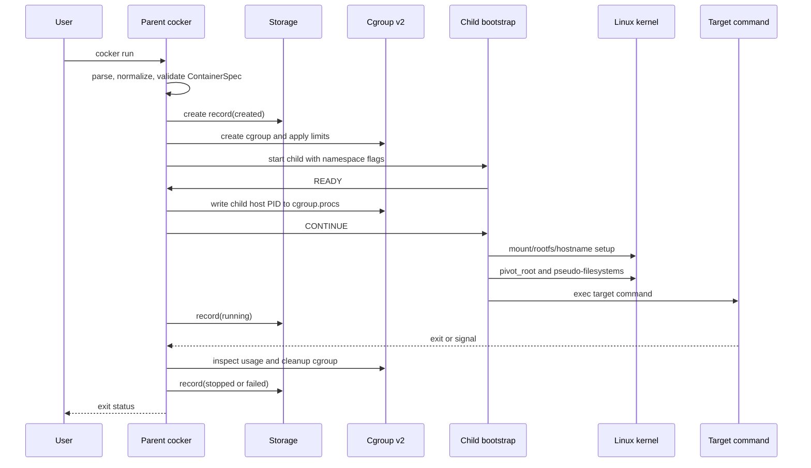

# End-to-End Container Run

## Статус документа

- Статус: draft
- Версия: 0.1
- Связанные документы:
  - [`docs/product/vision.md`](../product/vision.md)
  - [`docs/architecture/container-spec.md`](container-spec.md)
  - [`docs/architecture/cgroup-lifecycle.md`](cgroup-lifecycle.md)
  - [`docs/architecture/child-protocol.md`](child-protocol.md)
  - [`docs/architecture/signals-and-processes.md`](signals-and-processes.md)
  - [`docs/specs/container-lifecycle/states.md`](../specs/container-lifecycle/states.md)

## Назначение

Документ описывает полный сценарий `cocker run` для MVP и связывает отдельные архитектурные решения в одну последовательность.

## Пользовательский вызов

```text
cocker run \
  --rootfs ./rootfs \
  --memory 256MiB \
  --cpus 500m \
  --pids 64 \
  /bin/sh
```

## Общая последовательность



Диаграмма показывает логический порядок. Успешный `exec` подтверждается через close-on-exec protocol descriptor и совместную проверку EOF с process wait status.

## Этап 1: CLI и configuration

Parent:

1. разбирает command и flags;
2. загружает JSON, если указан `--config`;
3. применяет CLI overrides;
4. нормализует paths и resource values;
5. применяет namespace defaults;
6. валидирует `ContainerSpec`.

На этом этапе не создаются процессы, mounts, cgroups или metadata lifecycle resources.

Ошибка validation возвращается пользователю напрямую и не оставляет runtime state.

## Этап 2: создание metadata

Parent генерирует `ContainerID`, создаёт state directory и сохраняет record в состоянии `created`.

Record содержит:

- normalized `ContainerSpec`;
- ID и timestamps;
- ожидаемый state directory;
- будущие paths для logs;
- schema version.

Если запись record не удалась, runtime не начинает privileged setup.

## Этап 3: cgroup preparation

Parent проверяет cgroup v2, создаёт cgroup и записывает limits:

- `memory.max`;
- `cpu.max`;
- `pids.max`.

Если limit не задан, соответствующий control file не изменяется без отдельной policy.

Ошибка приводит к cleanup cgroup и state `failed` или удалению незапущенного record согласно lifecycle policy.

## Этап 4: child bootstrap

Parent создаёт Unix socketpair и запускает внутренний child mode через `os/exec`.

При создании процесса задаются нужные namespace flags:

- PID;
- mount;
- UTS;
- IPC;
- network.

User namespace не включается в MVP.

Child получает protocol descriptor и не запускает target command до `CONTINUE`.

Parent обновляет record до `starting` до или сразу после запуска child согласно atomic lifecycle implementation.

## Этап 5: cgroup membership

Child отправляет `READY`, когда готов ждать.

Parent получает host PID и записывает его в `cgroup.procs`. После успешной записи отправляется `CONTINUE`.

До этого момента target command не должна выполняться.

Если PID не удалось добавить в cgroup, parent отправляет `ABORT`, ждёт child и выполняет cleanup.

## Этап 6: child setup

После `CONTINUE` child:

1. проверяет inherited configuration;
2. настраивает hostname в UTS namespace;
3. делает mount propagation private;
4. подготавливает rootfs mount point;
5. выполняет `pivot_root`;
6. меняет текущую директорию на `/`;
7. монтирует `/proc` и необходимые pseudo-filesystems;
8. настраивает environment и working directory;
9. применяет security policy;
10. выполняет `exec` target command.

Каждая ошибка отправляется через startup protocol, если descriptor ещё доступен.

## Этап 7: переход в `running`

Parent должен зафиксировать `running` только после подтверждения, что child успешно прошёл bootstrap и target command заменил child image.

Предварительная схема:

- child пишет `STARTING_EXEC` непосредственно перед `exec`;
- protocol descriptor имеет close-on-exec;
- если `exec` успешен, descriptor закрывается kernel;
- если `exec` не удался, child отправляет `ERROR`;
- parent использует protocol result и состояние процесса, чтобы принять решение.

Эта схема требует отдельного тестирования, поскольку EOF канала и process wait должны интерпретироваться совместно.

## Этап 8: работа контейнера

Parent:

- сохраняет host PID;
- подключает stdio;
- ждёт process exit;
- обрабатывает stop requests и configured signals;
- сохраняет diagnostics.

Переход в `running` означает, что runtime передал управление target command. Это не обещает, что приложение внутри успешно работает на уровне бизнес-логики.

## Этап 9: остановка

При `cocker stop` или внешнем shutdown:

1. state становится `stopping`;
2. SIGTERM отправляется process set;
3. parent ждёт timeout;
4. оставшиеся процессы получают SIGKILL или group kill operation;
5. parent дожидается завершения;
6. сохраняются exit status и stop reason.

Повторный stop должен быть безопасным.

## Этап 10: cleanup

Cleanup выполняется в порядке, который не оставляет ресурсы:

1. закрыть protocol descriptors;
2. завершить process set;
3. размонтировать pseudo-filesystems и old root;
4. удалить mount resources;
5. прочитать доступный resource usage;
6. удалить cgroup;
7. закрыть logs;
8. атомарно сохранить final state.

Если cleanup отдельного ресурса уже выполнен, повторный вызов не должен считать это фатальной ошибкой.

## Ошибки и состояния

| Этап | Состояние до | Результат ошибки |
|---|---|---|
| validation | нет record | ошибка CLI |
| metadata | нет/created | record не запускается |
| cgroup setup | created | failed + cleanup |
| child startup | starting | failed + cleanup |
| rootfs setup | starting | failed + cleanup |
| target runtime | running | stopped с exit status |
| stop | running/stopping | stopped или failed |
| cleanup | stopping | final state с cleanup error |

## Конечный результат

Успешный run возвращает exit status target command и оставляет inspectable record со статусом `stopped`.

Ошибка до `exec` оставляет record со статусом `failed`, диагностикой этапа и результатом cleanup.

Ошибка cleanup не должна терять исходную причину завершения процесса.

## Критерии end-to-end готовности

- invalid configuration не создаёт kernel resources;
- metadata создаётся до запуска child;
- cgroup limits применяются до target command;
- child не обходит startup protocol;
- namespaces и rootfs setup происходят в child;
- `running` фиксируется только после успешного startup;
- stop учитывает descendants;
- final state сохраняется атомарно;
- повторный cleanup безопасен;
- integration test проверяет весь сценарий на Ubuntu VM.

## Решённые технические детали

- успешный `exec` подтверждается close-on-exec descriptor и process wait;
- `starting` сохраняется до запуска child, `running` — после подтверждённого `exec`;
- network namespace создаётся с поднятым loopback без внешней сети;
- mounts очищаются по reverse-order cleanup ledger;
- ошибки записи final state сохраняются в diagnostics и не маскируются.
